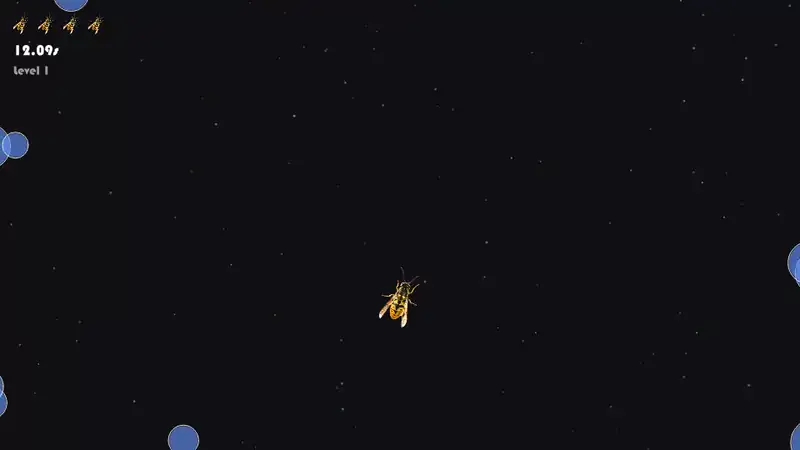
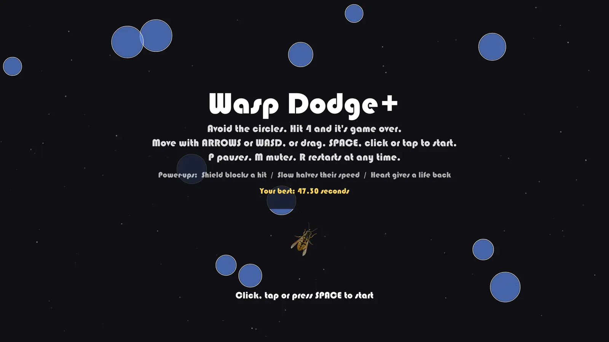
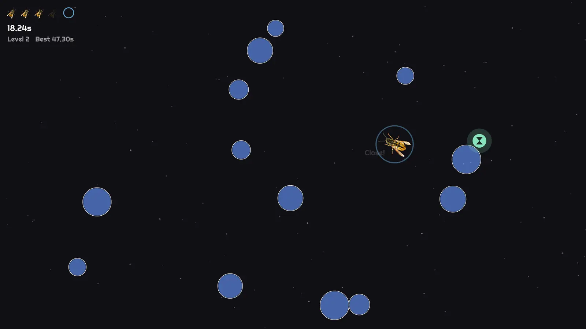
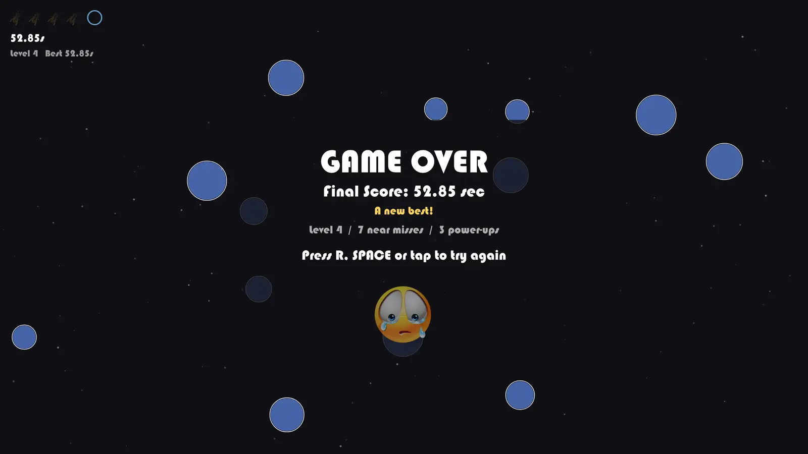
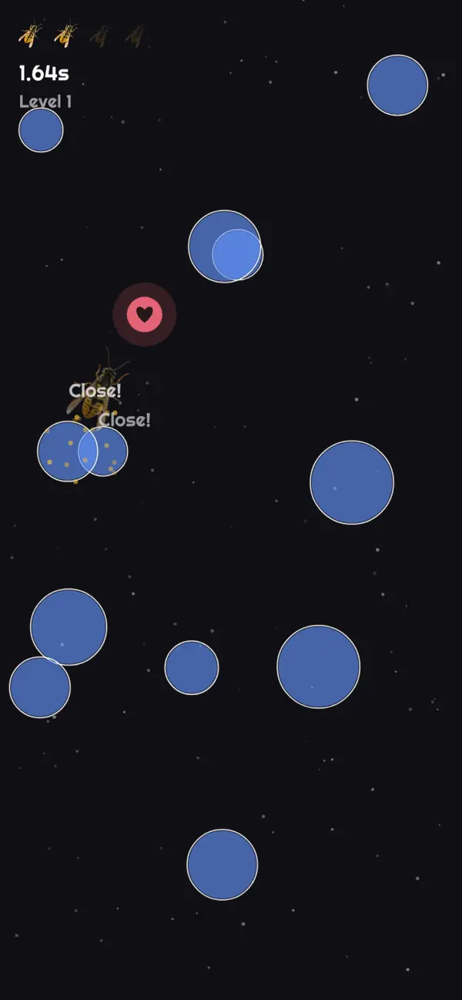
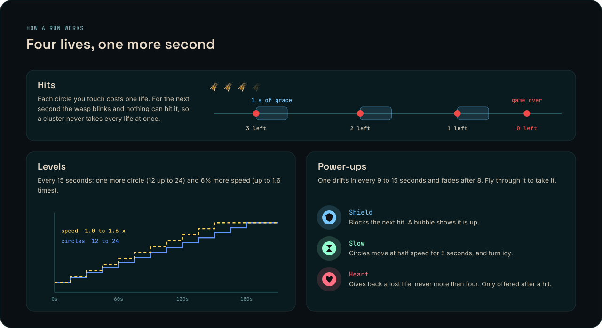

<p align="center">
  <a href="https://wasp-dodge.rayhanson.tech/"></a>
</p>

<p align="center">
  <a href="https://wasp-dodge.rayhanson.tech/"></a>
  
  
  
  
</p>

<p align="center">
  <a href="#about">About</a> ·
  <a href="#how-to-play">How to play</a> ·
  <a href="#how-a-run-works">How a run works</a> ·
  <a href="#how-it-is-built">How it is built</a> ·
  <a href="#run-it-locally">Run it locally</a> ·
  <a href="#status-and-limits">Status and limits</a> ·
  <a href="#changelog">Changelog</a>
</p>

## About

Wasp Dodge+ is a full-screen arcade game built around one simple challenge: guide a wasp through a field of moving
circles and stay in play for as long as possible. Four lives leave room to recover from a mistake, and a second of
grace after every hit stops a single bad moment from ending the run. The score is the time you survive, so every extra
second is the next small goal.

The game got harder and fairer in its 2026 upgrade. Every fifteen seconds a new level adds a circle and a little speed.
Power-ups drift in now and then: a shield, a slow-down, a spare life. Your best time is kept, near misses are counted,
and on a phone you can steer the wasp with your finger.

It was the midterm project for MTEC 1201. It lives in this course repository, in
[`Assignments/Midterm_Final_HarveyC`](.), and is published on its own at
[wasp-dodge.rayhanson.tech](https://wasp-dodge.rayhanson.tech/).

<p align="center">
  
</p>

<p align="center"><sub>A run recorded from the game itself in a headless browser, steered by a small test autopilot that is not part of the game.</sub></p>

## How to play

| Input | What it does |
|---|---|
| <kbd>Space</kbd>, **click** or **tap** | Starts a run from the menu, or a new one after game over. |
| <kbd>←</kbd> <kbd>↑</kbd> <kbd>→</kbd> <kbd>↓</kbd> or <kbd>W</kbd> <kbd>A</kbd> <kbd>S</kbd> <kbd>D</kbd> | Flies the wasp. Diagonals are as fast as straight lines. |
| **Drag** (finger or mouse) | The wasp flies towards your finger at the same top speed. The keyboard wins if you use both. |
| <kbd>P</kbd> or <kbd>Esc</kbd> | Pauses and resumes. Time spent paused does not count. |
| <kbd>M</kbd> | Turns the hit sound on or off. The choice is remembered. |
| <kbd>R</kbd> | Restarts at any time. |

You have **4 lives**. Touching a circle costs one, and for the next **second** the wasp blinks and cannot be hit.
Your score is the number of **seconds** you survive.

<table>
  <tr>
    <td width="50%"></td>
    <td width="50%"></td>
  </tr>
  <tr>
    <td align="center"><sub><b>The menu.</b> The circles keep moving behind it as a preview.</sub></td>
    <td align="center"><sub><b>Level 2.</b> Lives as small wasps, a shield bubble, and a Slow power-up nearby.</sub></td>
  </tr>
  <tr>
    <td width="50%"></td>
    <td width="50%" align="center"></td>
  </tr>
  <tr>
    <td align="center"><sub><b>Game over.</b> Your time, your best, and how the run went.</sub></td>
    <td align="center"><sub><b>On a phone.</b> Tap to start, drag to fly.</sub></td>
  </tr>
</table>

## How a run works

<p align="center">
  
</p>

- **Circles.** A run starts with 12. They fly in from the edges, bounce off the sides of the screen and get a small
  random nudge twice a second, so they never settle into a pattern.
- **Levels.** Every 15 seconds the level goes up: one more circle (up to 24) and 6% more speed (up to 1.6 times the
  start). Level 11 reaches the top speed and level 13 the most circles.
- **Power-ups.** One appears every 9 to 15 seconds and stays for 8, blinking in its last 2. **Shield** blocks the
  next hit. **Slow** halves the circles' speed for 5 seconds and turns them icy. **Heart** gives a lost life back;
  it is only offered after you have been hit, and you can never have more than four lives.
- **Near misses.** Passing within 16 px of a circle without touching it counts as a near miss. They don't change your
  score; they show on the game-over screen, as a measure of how bravely you flew.
- **Best time.** Your best score is kept in your browser, shown on the menu and in the corner, and the game-over
  screen tells you when you beat it.

## How it is built

Everything is in [`sketch.js`](sketch.js), in p5.js global mode, with p5.sound for the hit sound.

- **States.** `MENU`, `PLAY`, `PAUSE` and `GAMEOVER`. `draw()` runs the right updates and screens for each.
- **Movement.** The keys give a direction; a held finger gives one too, pointing from the wasp to the finger. The
  direction is normalised so diagonals are not faster, then scaled to 5 px a frame. The wasp turns smoothly towards its
  direction of flight; the picture's own heading (about −75°) is subtracted so its head leads.
- **Collisions.** Circle against circle: a hit when the distance between centres is less than the two radii. Only one
  hit can count per second, and the circle is pushed away so the wasp can escape.
- **Loading.** Each file (the wasp, the sad face, the font and the sound) is loaded with a fallback. If one is missing
  or blocked, the game starts anyway and draws a simple wasp, plain text or no sound in its place.
- **Effects.** A small burst of pieces and a short screen shake on every hit, floating words for levels, power-ups and
  near misses, and a blink while the wasp is safe.

## Run it locally

There is nothing to install or build. p5.js and p5.sound load from jsDelivr, pinned to version 1.9.2.

```bash
git clone https://github.com/Rayhanson-Git/MTEC1201_Harvey.git
cd "MTEC1201_Harvey/Assignments/Midterm_Final_HarveyC"
python3 -m http.server 8000
```

Then open <http://localhost:8000>. Use a local server rather than opening `index.html` directly: browsers block the
font and sound files on `file://` pages, and the game would then run without them.

```text
index.html        the page: p5.js and p5.sound from jsDelivr, meta and social tags
sketch.js         the whole game
wasp.png          the player
sadface.png       the game-over picture
gameover.mp3      the hit sound
fonts/            Righteous, the display font, with its licence (SIL Open Font License)
favicon.svg       the tab icon
assets/           README images: hero, diagram, screenshots, the demo recording and the social preview
design/           the script that draws the SVGs in assets/ (npm install && npm run build)
```

## Status and limits

- **Touch steering is a first version.** It works well for wide sweeps; very fine dodges are still easier with the
  keys.
- **It needs a network connection the first time**, to load p5.js and p5.sound from jsDelivr.

## Changelog

**November 2026: the upgrade.** Every rule from the original still holds: four lives, a second of grace after a hit,
the score as time survived, and Space, click, the arrows, WASD and R.

- **Levels**: every 15 seconds, one more circle and 6% more speed.
- **Power-ups**: Shield, Slow and Heart.
- **Best time**, kept between visits, and a game-over summary with the level, near misses and power-ups.
- **Touch and mouse steering**, so the game plays on phones and tablets.
- **Pause** (<kbd>P</kbd> or <kbd>Esc</kbd>) and **mute** (<kbd>M</kbd>), remembered.
- The wasp turns to face the way it flies, with a little wing bob; hits throw out a burst and shake the screen.
- Fixed: the game stayed on its loading screen for good if any one file failed to load. The old `try`/`catch` could
  not catch a failure that happens later, while the file downloads; each file now has a fallback.
- Fixed: after a game over and a restart, the mouse cursor was no longer hidden.
- Fixed: diagonal movement was 41% faster than straight movement.
- Fixed: the wasp picture was drawn squashed (3 × 2.4); it is square, as the file is.
- Changed: a dark card sits behind the menu and game-over text, and the arrow keys and Space no longer scroll the
  page.
- Changed: the display font is now [Righteous](https://fonts.google.com/specimen/Righteous) by Astigmatic, under the
  SIL Open Font License. The game used to ship a commercial typeface that is not free to redistribute.

## Credits

Made by Harvey Rayhanson ([rayhanson.tech](https://rayhanson.tech)) with [p5.js](https://p5js.org) and p5.sound.
The display font is Righteous by Astigmatic (SIL Open Font License, in [`fonts/OFL.txt`](fonts/OFL.txt)). No licence has been chosen for this repository, so all rights are reserved.
