<p align="center">
  <a href="Assignments/Midterm_Final_HarveyC/"></a>
</p>

# MTEC 1201: creative coding

My coursework for MTEC 1201, an introduction to creative coding with [p5.js](https://p5js.org). It runs from the first
shapes and colours to a full browser game: week-by-week class examples and exercises, the weekly assignments, and two
projects.

Made by Harvey Rayhanson ([rayhanson.tech](https://rayhanson.tech)).

## Projects

| Project | What it is | Play | Source |
|---|---|---|---|
| **Wasp Dodge+** (midterm) | A survival game: guide a wasp through moving circles on four lives. Upgraded in 2026 with levels, power-ups, a best time and touch steering. | [wasp-dodge.rayhanson.tech](https://wasp-dodge.rayhanson.tech/) | [`Assignments/Midterm_Final_HarveyC`](Assignments/Midterm_Final_HarveyC/) |
| **Orbit Playground** | An interactive canvas of orbiting dots; every click sets a new centre of motion. | [orbit-playground.rayhanson.tech](https://orbit-playground.rayhanson.tech/) | [Rayhanson-Git/orbit_playground](https://github.com/Rayhanson-Git/orbit_playground), and the course copy in [`Assignments/Final`](Assignments/Final/) |
| **Neon Orbit Arcade** | A glowing particle playground: the cursor becomes an orb and clicks open portals. | [neon-orbit.rayhanson.tech](https://neon-orbit.rayhanson.tech/) | [Rayhanson-Git/neon-orbit-final](https://github.com/Rayhanson-Git/neon-orbit-final) |

Orbit Playground and Neon Orbit Arcade, the end-of-semester projects, live in their own repositories. The copy of
Orbit Playground in `Assignments/Final` is the version that was handed in.

## What is in this repository

```text
Week 2 … Week 7               class examples and in-class exercises, one folder per week
Assignments/Week 2 … Week 4   weekly assignments (drawing tools and first sketches)
Assignments/Main Midterm Draft, Midterm/Draft
                              earlier drafts of the midterm game
Assignments/Midterm_Final_HarveyC
                              Wasp Dodge+, as published at wasp-dodge.rayhanson.tech (with its own README)
Assignments/Final             Orbit Playground, as handed in
```

Sketches that use a display font use Righteous by Astigmatic, under the SIL Open Font License (`OFL-Righteous.txt`
sits beside each copy).

Each folder is a self-contained p5.js sketch: open its `index.html` through a local server (for example
`python3 -m http.server`) to run it.

## Licence

No licence has been chosen for this repository, so all rights are reserved.
